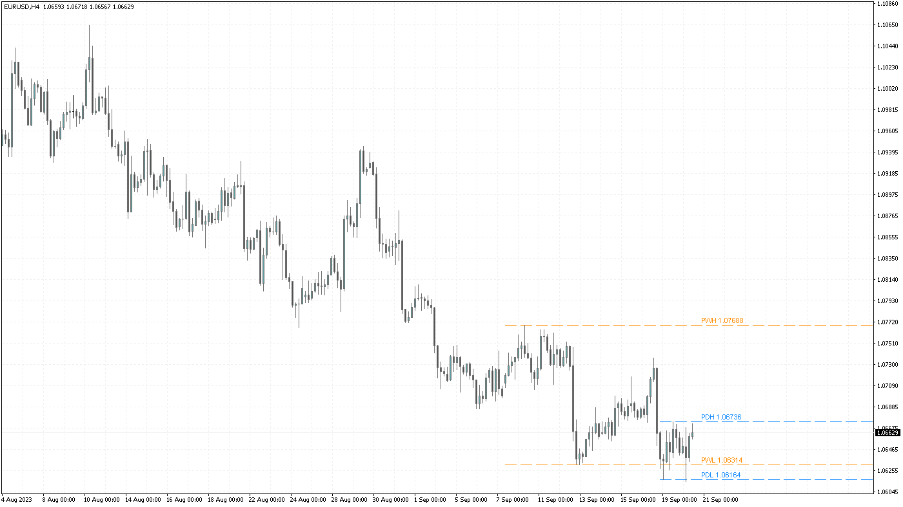

# Previous Day High Low Indicator MT4

Previous day, week and month high, low and close as horizontal lines, built from the chart's own bars (no D1/W1/MN history needed). Optional alert when price touches a level. Uses broker server time.

**Full guide, settings explained and strategy examples:** [Previous Day High Low Indicator MT4 on mt4indicators.com](https://mt4indicators.com/mt4-indicator/previous-day-high-low-indicator-mt4/)

## Features
- Free and open source (MIT licence), MQL4 source included
- Non-repainting: signals are calculated on closed candles and do not move once drawn.
- Works on any symbol and timeframe in MetaTrader 4 (build 600 or later)

## Inputs
| Input | Default | What it does |
|---|---|---|
| `ShowDay` | `true` | Show previous day levels |
| `ShowWeek` | `true` | Show previous week levels |
| `ShowMonth` | `false` | Show previous month levels |
| `ShowClose` | `false` | Also draw the previous close |
| `DayStartHour` | `0` | Day starts at this server hour (0-23) |
| `DayColor` | `clrDodgerBlue` | Day line color |
| `WeekColor` | `clrDarkOrange` | Week line color |
| `MonthColor` | `clrMediumOrchid` | Month line color |
| `LineStyle` | `STYLE_DASH` | Line style |
| `LineWidth` | `1` | Line width |
| `ShowLabels` | `true` | Show text labels |
| `AlertOnTouch` | `false` | Alert when price touches a level |
| `PushOnTouch` | `false` | Push notification on touch |

## Installation
1. Download `Previous-Day-High-Low.mq4` from this repository.
2. In MetaTrader 4 open **File → Open Data Folder → MQL4 → Indicators** and copy the file there.
3. Right-click **Indicators** in the Navigator and choose **Refresh** (or restart MT4).
4. Drag the indicator onto a chart.

Step-by-step screenshots: [How to install indicators in MT4](https://mt4indicators.com/how-to-install-indicators-mt4/).

## More free indicators
Browse 70+ free MetaTrader indicators, each checked for repainting, at [mt4indicators.com](https://mt4indicators.com/mt4-indicators/).

## Disclaimer
Trading foreign exchange on margin carries a high level of risk. This indicator is a charting tool, not trading advice. Test it on a demo account first.
